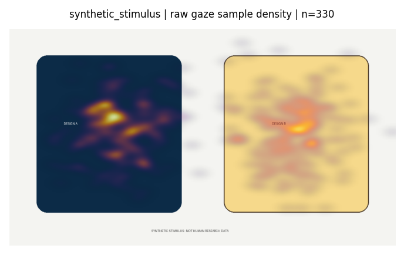

# Neuromarketing research: eye-gaze and facial-expression heatmaps

**University of Essex | MSc Computer Science | Final research project (2022-2023)**  
**Original coursework:** 2023 &nbsp;|&nbsp; **Repository refresh:** 2026 &nbsp;|&nbsp; **License:** MIT (software only)

An offline Python toolkit for cleaning iMotions sensor exports and exploring **where people looked** while viewing visual stimuli, together with **time-aligned facial-expression classifier scores**. It includes an optional Tkinter GUI, a command-line workflow, a de-identified research dataset and the original dissertation-era analysis notebooks (archived separately).

> **Research interpretation:** A gaze-density map shows the distribution of sampled gaze positions, **not** fixation duration or attention by itself. Facial-expression classifier outputs are **not direct measurements of felt emotion**, purchase intent, consumer preferences or marketing effectiveness. The visualisations are descriptive and require validated screen/stimulus calibration.

## Academic context

This repository began as the author's **final Master's research project in neuromarketing / visual perception**, completed as part of the **MSc Computer Science at the University of Essex during 2022-2023**. The original work investigated ways to bring eye tracking and facial-expression output from iMotions into interpretable visual overlays for image-based experiments. The initial 2023 code and notebooks are preserved under [`legacy/`](legacy/README.md).

In 2026 the project was restructured for public review and reproducibility: the code was made portable, gaze-expression alignment was made explicit, display dimensions were no longer assumed to be 1920 × 1080, an offline synthetic demonstration and tests were added, and identifying recording metadata was excluded from the research data release. **This refresh is not a new validation study and does not replace the 2023 dissertation findings.**

## What you can do

| Workflow | Command / location |
| --- | --- |
| Generate a working synthetic example without research participants | `python -m neuromarketing_heatmaps demo --output examples/generated` |
| Clean an original iMotions CSV or folder | `python -m neuromarketing_heatmaps clean ORIGINAL.csv --output cleaned.csv` |
| Analyse a released recording (gzip CSV supported) | `python -m neuromarketing_heatmaps summary data/public_recordings/REC001.csv.gz` |
| List stimulus codes found in a recording | `python -m neuromarketing_heatmaps stimuli data/public_recordings/REC001.csv.gz` |
| Split cleaned data into Excel sheets by stimulus | `python -m neuromarketing_heatmaps workbook cleaned.csv --output workbook.xlsx` |
| Plot a calibrated stimulus overlay | `python -m neuromarketing_heatmaps heatmap ...` (see below) |
| Run the desktop interface | `python gui.py` |
| Run the local tests | `python -m unittest discover -s tests -v` |

## Quick start

Python **3.10+** is recommended. No API key or network connection is required during normal use. Internet access may be needed **once** to install Python packages.

```bash
python -m venv .venv
# macOS / Linux
source .venv/bin/activate
# Windows PowerShell: .venv\Scripts\Activate.ps1
python -m pip install -e .
python -m neuromarketing_heatmaps doctor
python -m neuromarketing_heatmaps demo --output examples/generated
python gui.py
```

The synthetic demo writes `demo_gaze.png` and `demo_joy_weighted.png`, with a clearly labelled fictional stimulus. The image below is generated exclusively from **synthetic**, not participant, data.



### Use the included public research dataset

The `data/public_recordings/` directory contains **12 separately pseudonymised recordings** in compressed `.csv.gz` files. Each carries the relative timestamp, stimulus identifier, eye-gaze coordinates and expression-score series needed by the analysis workflow. These are **recordings, not a verified count of distinct people**. A manifest and privacy notes are in [`data/README.md`](data/README.md).

```bash
python -m neuromarketing_heatmaps summary data/public_recordings/REC001.csv.gz
python -m neuromarketing_heatmaps stimuli data/public_recordings/REC001.csv.gz
```

**Stimulus images and their actual screen location are not included.** Do not create a research interpretation by treating an arbitrary image as the original stimulus. To overlay original stimulus images, separately provide images you have the rights to share and the media's displayed width, height, left and top offsets from experiment calibration.

```bash
python -m neuromarketing_heatmaps heatmap data/public_recordings/REC001.csv.gz \
  --stimulus "YOUR_EXACT_STIMULUS_NAME" \
  --image /path/to/your/authorised-stimulus.png \
  --display-width 1920 --display-height 1080 \
  --display-left 0 --display-top 0 \
  --output overlay.png
```

`1920 x 1080` is an **example only**. Use the screen and media layout actually used during your recording. Add `--expression Joy --tolerance-ms 100` to make a time-matched **Joy-score-weighted gaze density** map. That is a classifier-weighted visualisation, not a measurement of emotion or a causal conclusion.

## Project layout

```text
neuromarketing_heatmaps/     Clean, align and visualise iMotions exports
  processing.py             Header detection, cleaning, gaze points, time matching
  visualisation.py          Heatmap creation and stimulus overlay
  cli.py                    Offline command-line entry points
  demo.py                   Reproducible, wholly synthetic example
gui.py                      Local Tkinter interface
data/public_recordings/      12 de-identified research recordings (.csv.gz)
data/manifest.json          Data provenance and row counts
examples/                   Synthetic figures and quick demonstration
legacy/                     Original 2023 code/notebooks with saved outputs cleared
tests/                      Regression and integration tests
docs/                       Research methods, disclosure and release notes
```

## Key methodological improvements

- Use coordinates from either valid eye, averaging left/right gaze **only when both are valid**.
- Distinguish gaze sample density from expression-score-weighted gaze density.
- Match nearest expression scores to gaze samples **within the same recording and stimulus**, using a configurable time tolerance (milliseconds, assuming the export uses that unit).
- Require explicit **media bounds** instead of assuming every recorded stimulus filled a 1920 × 1080 screen.
- Avoid treating missing emotion scores as zero. Filter and report excluded samples.
- Preserve the original coursework notebooks for historical traceability without carrying over personal file paths or cached output figures.

See [`docs/METHODS.md`](docs/METHODS.md) for assumptions, validation limits and interpretation.

## Data, ethics and licences

The uploaded raw archive contained ages, genders, date/time and study metadata. **Those original raw exports are intentionally not redistributed in this refreshed repository.** The released recordings contain selected analysis signals under new per-recording labels. The project author indicated approval to share the research data; that statement has **not been independently verified against the original participant consent, university permissions or third-party instrument terms**. The publisher remains responsible for establishing that the data can be publicly redistributed. See [`data/README.md`](data/README.md) and [`docs/PUBLICATION_AND_ETHICS.md`](docs/PUBLICATION_AND_ETHICS.md).

The included **software is MIT licensed** (see `LICENSE`). Do not assume that licence automatically applies to participant measurements, experiment images, iMotions software or proprietary classifier methods. Specific dataset reuse rights must be determined by the rights holder before assigning a data licence.

## Research results and limitations

The archived `Data_Analysis.ipynb` contains an **original coursework claim** that Random Forest achieved an R² of 0.644 for a specific emotion-peak regression task. That historical estimate is **not independently reproduced or validated here**. This updated toolkit demonstrates data processing and descriptive visualisation; it does **not** claim clinical validity, reliable emotion recognition, treatment outcomes or measured marketing effects.

## Citation

For attribution, cite this repository and its original 2023 MSc coursework context. See [`CITATION.cff`](CITATION.cff). Not affiliated with or endorsed by iMotions or the University of Essex.

## Updating the existing GitHub repository

The ZIP delivers a complete replacement working tree. See [`docs/UPDATE_GITHUB.md`](docs/UPDATE_GITHUB.md) for safe instructions to update the existing repository **without losing its commit history**.
